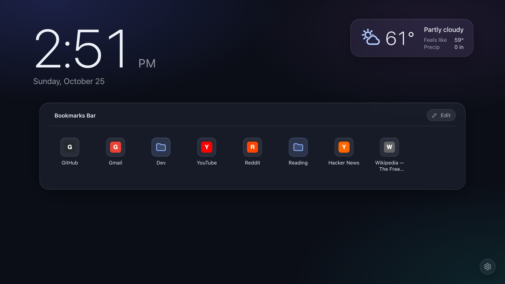
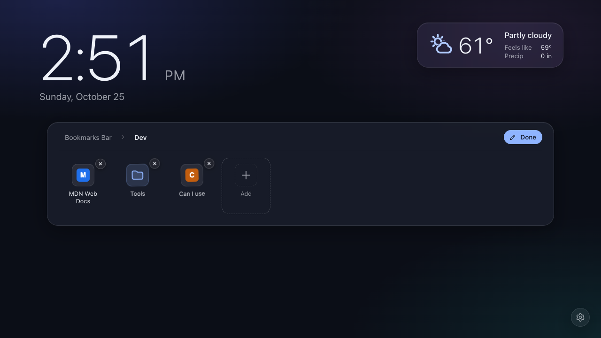
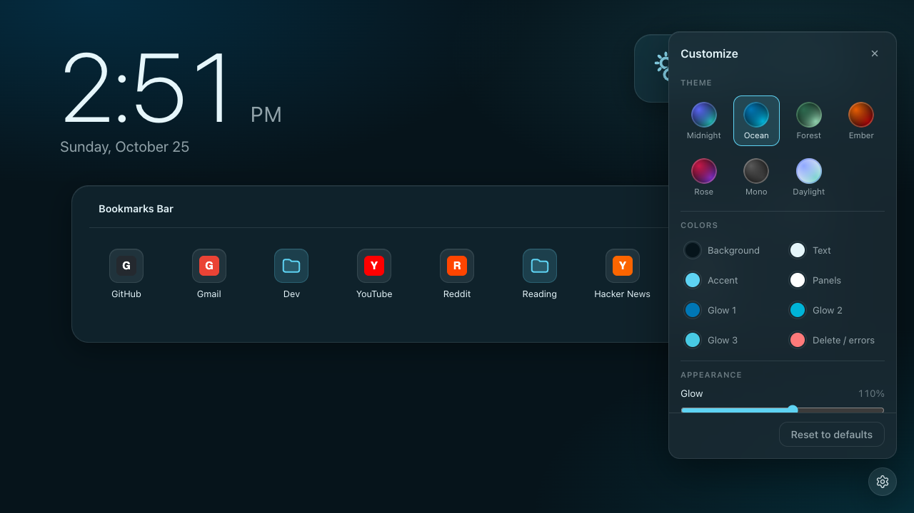

# Chromium Bookmarks New Tab

A Manifest V3 browser extension that replaces the Chromium new tab page with your Bookmarks Bar in the middle of the screen, Safari-style, plus a clock, local weather, and a theme you can customize.

I got frustrated that Brave's new tab page couldn't put my bookmarks front and center the way Safari does, so I built this to override it.

## What it does
- Shows everything on your **Bookmarks Bar** as a grid with favicons.
- Lets you open folders and jump back to any parent with a breadcrumb trail.
- Lets you manage bookmarks right on the page. Changes go to your real Bookmarks Bar, so they show up in the browser and sync like any other bookmark edit:
  - **Edit** mode adds bookmarks or folders, and removes items (with a confirmation).
  - Drag a tile to reorder it, drop it on a folder to move it inside, or drop it on a breadcrumb to move it up a level.
  - Right-click a tile to rename it or edit its URL.
- Has a **settings** panel (gear button, bottom right):
  - Theme presets, plus color pickers for the background, text, accent, panels, background glows and delete/error color.
  - Sliders for glow strength, panel opacity and blur, bookmark size and corner roundness.
  - 12/24-hour clock, show/hide the date and weather, and °F/°C.
  - Settings sync across your devices via `chrome.storage.sync`.
- Shows a live clock and the current weather for your approximate location.
- Works in any Chromium browser (Brave, Chrome, Edge, …).

## Tech stack
Vanilla JavaScript (ES modules) · HTML/CSS · Chrome Extensions Manifest V3 (`chrome_url_overrides`, `bookmarks`, `storage`, `favicon`) · ip-api.com · Open-Meteo

## How it works
- `manifest.json` overrides `newtab` with `customHome.html` and requests the `bookmarks`, `storage` and `favicon` permissions.
- `bookmarks.js` finds the Bookmarks Bar with `chrome.bookmarks.getTree()`, tracks the current folder path for the breadcrumbs, and renders the folder's children with `chrome.bookmarks.getChildren()`. Adding, removing, renaming and moving call `create`, `remove`/`removeTree`, `update` and `move`. The grid re-renders on the `chrome.bookmarks` change events, so edits made elsewhere in the browser show up too.
- Favicons come from the extension's built-in `/_favicon/` endpoint, so the page never fetches from the sites themselves.
- `settings.js` builds the settings panel, saves to `chrome.storage.sync`, and applies the theme by setting a handful of CSS custom properties on `:root`. `customHome.css` derives every other shade (hover states, borders, muted text) from those with `color-mix()`.
- `theme-boot.js` is a tiny non-module script in `<head>` that applies a `localStorage` copy of the theme before first paint, so the page never flashes the default colors.
- `weather.js` gets an approximate location from ip-api.com, then fetches current conditions from Open-Meteo in your chosen unit. Neither API needs a key.
- `customHome.js` wires it together and runs the clock; `icons.js` holds the inline SVG icons.

## Install (load unpacked)
1. `git clone https://github.com/amcnutt1996/chromium-bookmarks-newtab.git`
2. Open your browser's extensions page (`chrome://extensions`, `brave://extensions`, …) and turn on **Developer mode**.
3. Click **Load unpacked** and select the `chromium-bookmarks-newtab` folder.
4. Open a new tab. Some browsers show a footer you may need to disable.

## What I learned
- How Manifest V3 extensions declare page overrides and permissions, and how little code it takes to change core browser UI.
- Turning a recursive data structure (the bookmark tree) into navigable UI state.

## License
[MIT](LICENSE)
